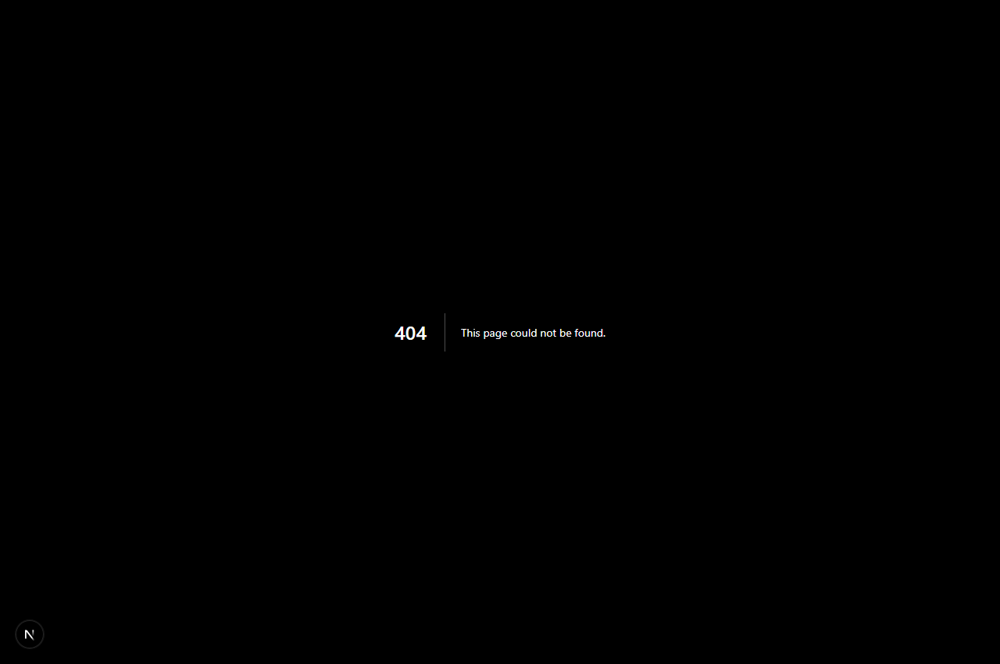
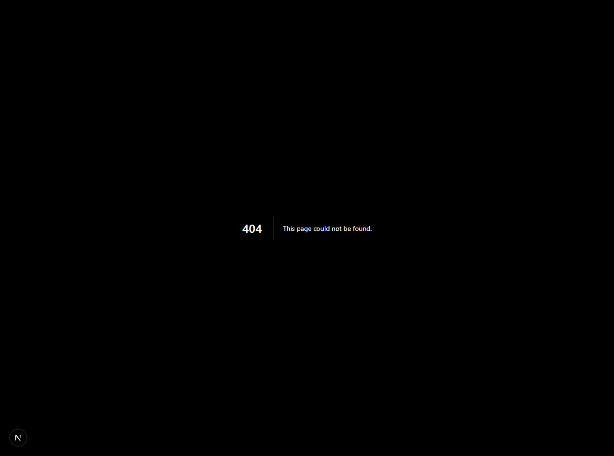

# Modern Authentication UI (Login, Register & Recovery)

A modern, accessible, and responsive Login, Registration, and Password Reset UI with client-side validation and a mock authentication layer built with **Next.js 16**, **React 19**, and **TypeScript**.

---

## 📸 Interface Preview

### 1. Sign In Page (`/login`)
Split-screen desktop layout with dark brand stage and crisp form sheet:



---

### 2. Registration Page (`/register`)
Two-section structured form with live 4-segment password strength engine and real-time field validation:



---

### 3. Password Recovery Page (`/forgot-password`)
Clean password reset request interface with OWASP-compliant response handling:


---

## ✨ Features

- **Split Screen Layout:** 45% dark stage with animated perspective grid & ambient lighting; 55% soft paper form side.
- **Client-Side Validation:**
  - Standard email format validation (RFC 5322).
  - Sri Lankan phone number normalisation (`+94` / `07x`).
  - Full name checks supporting Unicode characters (Latin, Sinhala, Tamil).
  - Live 4-tier password strength meter (Weak / Fair / Good / Strong).
  - Real-time password confirmation match indicator.
- **Interactive Password UX:**
  - Show / Hide toggle with accessible `aria-pressed` states.
  - Automatic **Caps Lock** detection badge.
- **Mock Authentication Layer (`mock-auth.ts`):**
  - Simulated latency and realistic server responses.
  - Demo login credentials: `demo@zegbit.lk` / `Demo@1234`.
  - OWASP anti-user-enumeration (generic error messages).
  - Rate limiting with 30-second cooldown after 5 failed attempts.
  - Zero sensitive data stored in local storage, cookies, or browser logs.
- **Responsive & Accessible (WCAG AA):**
  - Mobile collapsing header band, full touch targets (44px+), visible focus rings, and `prefers-reduced-motion` compliance.

---

## 🛠️ Tech Stack

- **Framework:** Next.js 16 (App Router)
- **Library:** React 19
- **Language:** TypeScript
- **Styling:** Custom CSS Design Tokens & PostCSS
- **Icons:** Lucide React

---

## 🚀 Getting Started

### Prerequisites
Make sure you have Node.js 18+ installed on your system.

### Installation

1. Clone the repository:
   ```bash
   git clone https://github.com/sandunawa/custom-login-register-ui.git
   cd custom-login-register-ui/frontend
   ```

2. Install dependencies:
   ```bash
   npm install
   ```

3. Start the development server:
   ```bash
   npm run dev
   ```

4. Open your browser and navigate to:
   - **Login:** [http://localhost:3001/login](http://localhost:3001/login)
   - **Register:** [http://localhost:3001/register](http://localhost:3001/register)
   - **Forgot Password:** [http://localhost:3001/forgot-password](http://localhost:3001/forgot-password)

---

## 🧪 Demo Credentials

To test the successful authentication flow:
- **Identifier:** `demo@zegbit.lk`
- **Password:** `Demo@1234`

To test email collision during registration:
- **Email:** `taken@zegbit.lk`
